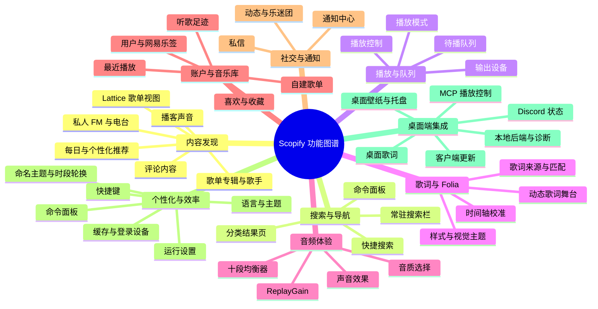

<div align="center">


<h1>Scopify</h1>

<p>一个仿 Spotify UI 的跨平台音乐播放器</p>

<p>
  <a href="https://scopify-web.vercel.app">在线体验</a> ·
  <a href="https://scopify-docs.vercel.app">开发文档</a> ·
  <a href="https://github.com/MT-SUPER-POWER/Scopify/releases">下载客户端</a> ·
  <a href="https://vdoonnridu.apifox.cn/">后端 API</a>
</p>

[](https://github.com/MT-SUPER-POWER/Scopify/stargazers)
[](https://github.com/MT-SUPER-POWER/Scopify/releases)
[](https://github.com/MT-SUPER-POWER/Scopify/blob/master/license)
[](https://deepwiki.com/MT-SUPER-POWER/Scopify)
[](https://github.com/MT-SUPER-POWER/Scopify/actions/workflows/ci.yml)
[](https://github.com/MT-SUPER-POWER/Scopify/actions/workflows/release.yml)

</div>


## 简介

这是一个基于 Next.js + Electron 配合网易云 node.js API 的一个客户端音乐播放器，是我初学 Electron 的第一个作品。

- 本项目主要技术链为 [Next.js](https://nextjs.org/) + [TypeScript](https://www.typescriptlang.org/) + [ShadCN UI](https://ui.shadcn.com/) + [Electron](https://www.electronjs.org/zh/docs/latest/) + [Nodejs](https://nodejs.org/zh-cn/) + [Turborepo](https://turbo.build/)
- Node.js 版本要求：>= 24，包管理器：pnpm 12.x（见 `packageManager`），脚本与测试运行时：bun >= 1.3.11
- 支持网页端与客户端，由于设备有限，目前仅保证 Windows 系统的适配，App 开发中

## 技术栈总览

1. Next.js + React: 前端框架
2. Electron: 桌面应用框架
3. Tailwind CSS: CSS 框架
4. shadnCN UI: UI 组件库
5. Docker: 部署部分
6. Axios + TanStack Query: 后端通讯统一管理部分
7. Zustand: 前端状态管理
8. Eslint + Prettier + Husky: 代码格式化约束 + Git 提交规范
9. Framer-Motion: 动画框架
10. TanStack-Virtual: 虚拟列表
11. WebGL: 歌词舞台可视化

### 代码结构

仓库使用 pnpm Workspaces + Turborepo 管理 Web、Electron 和共享契约：

```text
repo/
├── frontend/
│   ├── apps/
│   │   ├── web/                 # Next.js Web 与 Electron Renderer 源码
│   │   ├── desktop/             # Electron 主进程、预加载与打包配置
│   │   └── mobile/              # Flutter 预留入口（submodule）
│   └── packages/
│       └── desktop-contract/    # Web 与 Electron 之间的类型化契约
└── backend/
    └── api-enhanced/            # NetEase API 后端（submodule）
```

新建或修改代码前，请先阅读：

- **[AGENTS.md](./AGENTS.md)** — 项目结构规范
- **[docs/structure.md](./docs/structure.md)** — 面向贡献者的结构说明与迁移进度

### 重要的三方库

> 特别感谢以下项目的开源：

1. [Folia](https://github.com/chthollyphile/folia-major/tree/main)
2. [Netease Cloud Music API Enhanced](https://github.com/neteasecloudmusicapienhanced/api-enhanced)

### 参考文档

1. [Folia Source Snapshot](https://github.com/chthollyphile/folia-major/tree/main)
2. [Electron Doc](https://www.electronjs.org/zh/docs/latest/api/app)
3. [Netease Cloud Music API Doc](https://docs-neteasecloudmusicapi.focalors.ltd/#/)
4. [Electron Builder Help Doc - Not Official](https://github.com/QDMarkMan/CodeBlog/blob/master/Electron/electron-builder%E6%89%93%E5%8C%85%E8%AF%A6%E8%A7%A3.md)

## 部署方法

Scopify 现在把桌面客户端、Web 前端和后端分开管理。Web 和桌面客户端需要能访问一个独立运行的 NetEase API 后端。

### 后端的运行

> 请确保你后端的实际运行
> 当然你也可以看这个文档[部署文档](https://scopify-docs.vercel.app/docs/deployment)来部署你的专有后端作为项目后端运行。

```bash
git submodule update --init --recursive   # 初次克隆时需要
pnpm run dev:backend                       # 运行后端
```

### 前端与桌面客户端的运行

```bash
pnpm install
pnpm run dev:web          # 仅 Next.js Web
pnpm run dev:desktop      # 仅 Electron（开发时使用 Web dev server），确保你的 dev:web 已运行
pnpm run dev              # Web + Electron
pnpm run dev:full         # Web + Electron + backend

# 其他网页
pnpm run dev:docs         # 仅 docs（文档网站），确保你的 dev:web 已运行
```

## 功能

功能与界面会随版本持续更新。你可以通过下面的功能图谱快速了解产品能力，完整说明与最新界面截图请查看在线文档：



- **[产品能力](https://scopify-docs.vercel.app/docs/features)**：按使用场景整理的完整功能说明与最新界面截图
- **[快捷键](https://scopify-docs.vercel.app/docs/shortcuts)**：全部快捷键与命令
- **[版本日志](docs/CHANGELOG.md)**：每个版本新增、改进与修复的内容

本地预览文档站：`pnpm run dev:docs`（需先运行 `pnpm run dev:web`）。

## 版本号规则

> 版本号的发布规则 `x.y.z`

- `x`: 重大更新，可能包含不兼容的 API 修改
- `y`: 次要更新，添加了新功能，但保持向后兼容
- `z`: 修复 bug 和小的改进，不添加新功能

## 开源许可

本项目基于 [GNU Affero General Public License v3.0 (AGPL-3.0)](https://www.gnu.org/licenses/agpl-3.0.html) 许可开源。

- **修改与分发：** 任何修改或分发都必须同样基于 **AGPL-3.0**，并提供完整源代码。
- **派生作品：** 必须同样采用 **AGPL-3.0**，并在适当位置保留本项目的许可与版权信息。
- **署名：** 必须保留原作者及版权信息。可为二次开发添加你自己的署名，但不得移除或篡改原始信息。
- **商业用途：** 如用于售卖或其他盈利用途，必须提供源代码及原项目链接。由于本项目涉及第三方服务，商业使用可能存在法律风险。
- **免责：** 本软件按「现状」提供，不附带任何形式的担保，详见 AGPL-3.0。
