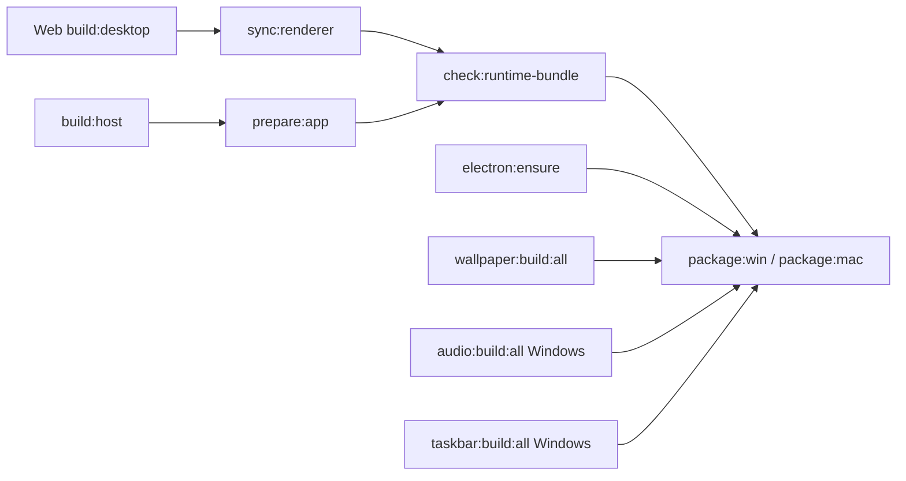
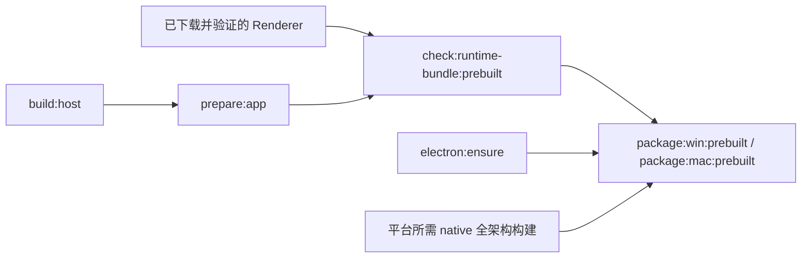

# Build artifacts

桌面构建采用「Turbo 声明依赖、脚本执行单一步骤」的结构。仓库根目录提供开发者入口，Desktop 的任务关系集中在 `repo/frontend/apps/desktop/turbo.json`；`package.json` 不再用 `&&` 串联原生构建、宿主编译、目录准备、校验与打包。

## 产物目录与所有权

`repo/frontend/apps/desktop/lib/runtimePaths.ts` 定义生产应用目录与发行目录，Electron Vite、同步脚本和 Electron Builder 使用同一套路径。构建辅助脚本统一收拢在 `scripts/native/`（原生构建与单体验证）和 `scripts/build/`（渲染层同步与组装校验）中。

```text
repo/frontend/apps/desktop/
├── out/main/                    # electron-vite dev 的 Main / Preload
├── native/
│   ├── wallpaper-helper/        # Cargo target/、生成的 .node 与声明文件
│   ├── audio-engine/            # Windows 原生音频产物
│   └── taskbar-lyric/           # Windows 任务栏歌词产物
└── build/
    ├── desktop/app/             # electron-builder 的 app 输入，也是完整的可运行应用目录
    │   ├── out/main/            # 生产 main.js 与 preload.js
    │   ├── renderer/            # 静态 Next 页面与 renderer.manifest.json
    │   ├── public/              # 从 Desktop public/ 复制的静态资源
    │   ├── native/              # 当前构建已就绪的原生模块 .node 产物与类型定义
    │   └── package.json         # 剔除开发脚本和 workspace 依赖的运行时清单
    └── release/                # 安装包、更新元数据及 unpacked 验证目录
```

最终安装包位于 `build/release/`；原生编译中间文件和 NAPI 产物仍由各自的 `native/` 模块维护，由 `prepare:app` 同步至 `build/desktop/app/native/` 形成完整应用目录。Electron Builder 按目标架构将原生模块复制到应用资源目录。

## 本地构建任务图



- `build:host` 仅调用 Electron Vite，编译 Main / Preload；先准备 Electron 并保留对上游 `^build` 的依赖，不再自行编译 native、复制资源或运行校验。
- `prepare:app` 等待宿主编译完成，生成运行时 package.json，复制 public 资源并同步已构建的原生 native 模块。它只更新自己拥有的目录，不清空 Renderer 或宿主输出。
- `sync:renderer` 等待 Web 桌面静态导出，将 `apps/web/out/` 同步到应用的 renderer 目录，写入 manifest 后删除 Web 的临时导出目录。同步不缓存，因此每次可使用当前的提交信息；Web 导出仍可从 Turbo 缓存恢复。
- `check:runtime-bundle` 等待宿主目录准备与 Renderer 同步，验证 Main / Preload、沙箱 preload 及 Renderer 内容。这是 JS 应用组装的检查，不代替各 native 脚本的产物和 ABI 校验。
- `build` 是 Desktop 的虚拟聚合任务，依赖 `build:native`、`build:host` 与 `prepare:app`，生成完整的桌面 JS 运行时和原生模块。
- `package:win` 等待运行时校验、Electron 安装、三个 native 全架构任务；`package:mac` 只等待对应校验、Electron 和 wallpaper 全架构任务。平台打包脚本本身只调用 Electron Builder。

Renderer、宿主与不同 native 模块可以在依赖允许时并行。每个 native 模块内部的 x64 / arm64 构建仍由已有 TS 脚本顺序处理，避免同一模块的 `index.d.ts` 和 NAPI 事务目录并发覆盖。

## 命令入口

在仓库根目录运行这些入口，由 Turbo 处理完整的依赖关系：

| 命令 | 行为 |
| --- | --- |
| `pnpm run dev:desktop` | 先准备 Electron 和本机 wallpaper，再启动 Electron Vite；`pnpm run dev` 同时启动 Web |
| `pnpm run sync:renderer` | 静态导出 Web 桌面页面并同步 Renderer |
| `pnpm run build:desktop` | 编译宿主、准备应用目录（含 native）、同步并校验 Renderer，不生成安装包 |
| `pnpm run package:win` / `pnpm run build:win` | 同一条完整 Windows 安装包任务图，包含 x64 / arm64 native |
| `pnpm run package:mac` / `pnpm run build:mac` | 同一条完整 macOS 任务图，包含两个架构的 wallpaper |

`build:win` 与 `build:mac` 是兼容入口，直接选择对应的 Turbo package 任务，不再串行调用两条构建命令。Desktop 删除旧 `predev` 生命周期脚本，开发前置关系也在 Turbo 中；直接运行工作区内部的叶子脚本不负责补齐依赖。

## CI：复用唯一的 Renderer

Release workflow 在 Linux 的 renderer job 中构建一次页面，生成 manifest 和归档校验和。平台 job 下载同一份归档、验证校验和与 source revision，再进入以下任务图：



`check:runtime-bundle:prebuilt` 复用同一套运行时校验脚本，但只将应用目录准备声明为构建依赖，不调度 `sync:renderer` 或 Web 构建。Renderer 不存在或不合法时直接失败。prebuilt 的平台任务复用同一组 native 任务；其叶子脚本与本地平台任务调用相同的 Electron Builder 命令。

CI 的平台 job 只调用一次 `turbo run package:<平台>:prebuilt --filter=@scopify/desktop`，由任务图准备 Electron、编译宿主与 native、校验后打包，不再额外串行执行宿主构建。Rust 目标与 Cargo 缓存仍由 `setup-native-build` action 准备；默认分支的 native 缓存预热 workflow 也通过 Turbo 选择同一组 `*:build:all` 任务，不另写一条编译链。发布仍通过版本 tag 触发，打包任务使用 `--publish never`，发布动作由 release job 统一执行。

## 缓存与验证边界

Web 构建继续缓存静态导出。宿主、目录组装、Renderer 同步、native、Electron 安装、运行时校验和安装包任务暂不使用 Turbo 成功缓存；native 仍可复用 Cargo 自己的编译缓存。编排与缓存分别处理，后续只有在补齐平台、架构、工具链输入及完整产物声明后，才为 native 开启 Turbo 缓存。

native 目录当前不纳入 pnpm workspace，仍由 Desktop 的叶子脚本调用，平台选择、交叉编译与 ABI 检查保留在 TS 脚本内。此次整理没有迁移 Rust 模块位置，也没有改写编译器调用。

检查任务图可使用 `pnpm exec turbo run package:win --filter=@scopify/desktop --dry=json`；CI 路径将任务名换成 `package:win:prebuilt`。后者不应出现 Web 构建或 Renderer 同步。dry-run 验证编排关系，不证明编译、原生加载、签名或安装包运行通过。
