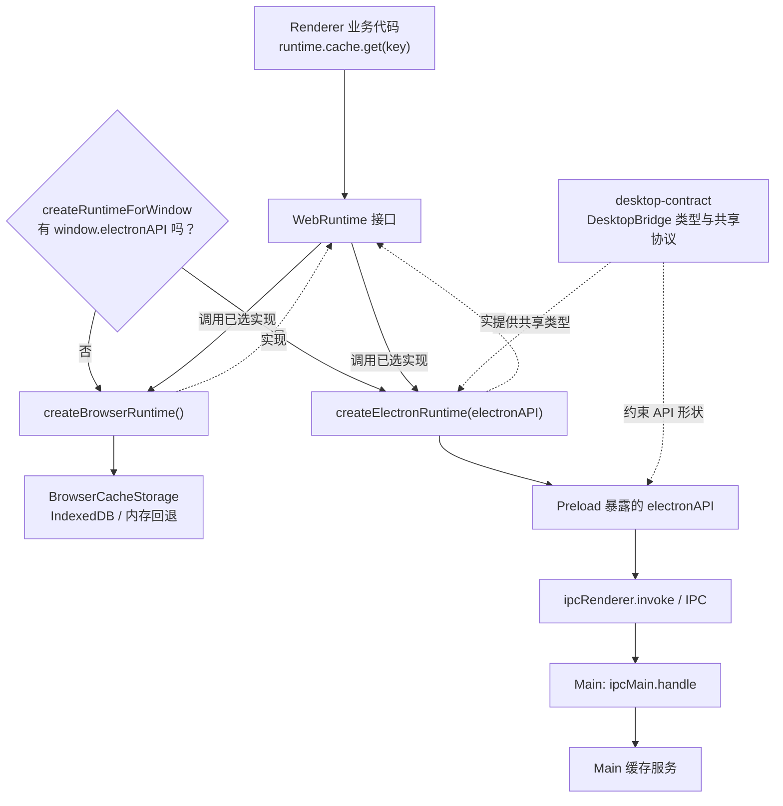

# WebRuntime 双端分流与 Electron IPC 调用链

> 适用范围：Scopify 当前共享 Next.js Renderer 的 Web / Electron 架构。本页解释现有实现，不是迁移提案。另见 [Desktop Contract 包说明](../../repo/frontend/packages/desktop-contract/README.md) 与 [桌面端架构全景](../../repo/frontend/apps/desktop/docs/architecture.md)。

## 一、为什么需要 Runtime？

Scopify 当前的 Next.js Renderer 既能在普通浏览器中运行，也能被 Electron 桌面应用加载。相同的 UI/业务代码可能需要缓存、窗口控制、登录等宿主能力，但浏览器和 Electron 的实现不同。

业务层统一依赖 `WebRuntime`，例如：

```ts
import { runtime } from "@/lib/runtime";

const cached = await runtime.cache.get("playlist:123");
```

组件不必为同一个业务动作分别写 `if (isElectron)`、浏览器 API 和 IPC 调用。

**重要边界：** `WebRuntime` 是业务层的统一接口；`DesktopBridge` 是 _Electron Preload 向 Renderer 暴露的 API 的类型契约_。它们不是同一层，不要求方法逐一同名，也不表示每一个桌面能力都必须有真正等价的浏览器实现。

## 二、总览：初始化分流与执行路径



上图中 `R` 到两个实现表示**可能的执行分支**，不是一次调用同时执行两条路线。平台选择在 Runtime 初始化时完成，通常不会在每次 `cache.get` 时重新检测。

如果 Markdown 环境不渲染 Mermaid，可按下面的 ASCII 路线理解：

```text
                  业务代码 runtime.cache.get(key)
                               |
                   已选中的 WebRuntime 实现
                        /               \
               BrowserRuntime       ElectronRuntime
                    |                    |
            BrowserCacheStorage   window.electronAPI
                    |                    |
                 IndexedDB             Preload
             (不可用则内存)        ipcRenderer.invoke
                                         |
                                  IPC 到 Main 进程
                                         |
                                  ipcMain.handle
                                         |
                                    桌面缓存服务
                        \               /
                          返回 Promise 结果

DesktopBridge 类型声明 --约束--> Preload 的 electronAPI
                         --供类型检查--> Renderer / ElectronRuntime
它不在运行时请求路径中。
```

## 三、从启动到 Runtime 被选中

### 1. Electron 创建窗口并加载 Preload

Electron Main 创建 `BrowserWindow`，通过 `webPreferences.preload` 指向构建好的 Preload 脚本。Preload 在 Renderer 进程的隔离上下文中执行，**并非独立的第三个业务进程**。

当前 Preload 的入口是 [`apps/desktop/electron/preload/index.ts`](../../repo/frontend/apps/desktop/electron/preload/index.ts)。其核心逻辑（摘取关键行）：

```ts
const electronAPI: DesktopBridge = {
  getPageCache: (key) => ipcRenderer.invoke("cache:get", key),
  // 更多受控的桌面 API……
};

contextBridge.exposeInMainWorld("electronAPI", electronAPI);
```

`contextBridge` 将可调用的方法暴露给 Renderer 的 `window.electronAPI`。它**不会生成 TypeScript 文件**，也不会将 `ipcRenderer` 整体暴露给页面。

### 2. Web 端声明 `window.electronAPI` 的类型

[`apps/web/types/electron.d.ts`](../../repo/frontend/apps/web/types/electron.d.ts) 中：

```ts
import type { DesktopBridge } from "@scopify/desktop-contract";
import type { LyricData } from "@/types/lyrics/model";

declare global {
  interface Window {
    electronAPI?: DesktopBridge<LyricData>;
  }
}
```

这只让 TypeScript 知道 `window.electronAPI` 的形状；该属性能否在运行时使用取决于 Preload 是否成功执行并暴露对象。`?` 表示普通 Web 环境中可能没有该属性。

### 3. 根据对象是否存在选择适配器

[`apps/web/lib/runtime/index.ts`](../../repo/frontend/apps/web/lib/runtime/index.ts) 的真实选择逻辑：

```ts
export function createRuntimeForWindow(rendererWindow: Pick<Window, "electronAPI"> | undefined) {
  if (rendererWindow?.electronAPI) {
    const runtime = createElectronRuntime(rendererWindow.electronAPI);
    installRendererConsoleBridge(runtime.logging);
    return runtime;
  }
  return createBrowserRuntime();
}

const runtime = createRuntimeForWindow(typeof window === "undefined" ? undefined : window);
export { runtime };
```

- 能取得 `window.electronAPI`：创建 ElectronRuntime，并传入**真实对象**。
- 否则：创建 BrowserRuntime；在没有 `window` 的执行环境里也不会寻找 Preload。
- 两者都满足 [`WebRuntime` 接口](../../repo/frontend/apps/web/lib/runtime/types.ts)，组件只依赖 `runtime` 导出。

**不存在** “把 `DesktopBridge` 类型实例化后接入 IPC” 的步骤：`DesktopBridge` 是编译期接口，执行时传递的是 Preload 暴露的 JS 对象。

## 四、一条 API 的两种落地方式：`runtime.cache.get(key)`

### 共有的业务入口

[`types.ts`](../../repo/frontend/apps/web/lib/runtime/types.ts) 定义：

```ts
interface RuntimeCache {
  get<T = unknown>(key: string): Promise<T | null>;
  // 其他缓存操作……
}
```

`WebRuntime.cache` 使用这份接口，业务调用完全相同。

### A. 浏览器路径：不经过 IPC

[`apps/web/lib/runtime/adapters/browser.ts`](../../repo/frontend/apps/web/lib/runtime/adapters/browser.ts)：

```ts
cache: {
  get: <T>(key: string) => getScoped<T>("page", key),
}
```

`getScoped` 从 `cacheStorage.get(scope, key)` 读取记录，处理过期时间，并更新访问时间。存储层位于 [`apps/web/lib/cache/browserCacheStorage.ts`](../../repo/frontend/apps/web/lib/cache/browserCacheStorage.ts)：可用 IndexedDB 时使用 IndexedDB；没有 IndexedDB 时退回内存存储。

```text
runtime.cache.get(key)
  -> BrowserRuntime.cache.get
  -> getScoped("page", key)
  -> cacheStorage.get("page", key)
  -> IndexedDB（或内存存储）
  -> Promise<T | null>
```

### B. Electron 路径：通过 Preload + IPC + Main

**第一站，ElectronRuntime**：[ `adapters/electron.ts` ](../../repo/frontend/apps/web/lib/runtime/adapters/electron.ts)

```ts
cache: {
  get: <T>(key: string) => bridge.getPageCache<T>(key),
}
```

这里的 `bridge` 就是 `createElectronRuntime(window.electronAPI)` 收到的对象。

**第二站，Preload**：[ `preload/index.ts` ](../../repo/frontend/apps/desktop/electron/preload/index.ts)

```ts
getPageCache: (key) => ipcRenderer.invoke("cache:get", key),
```

**第三站，Main**：[ `main/ipc/cache.ts` ](../../repo/frontend/apps/desktop/electron/main/ipc/cache.ts)

```ts
ipcMain.handle("cache:get", (event, key: string) => {
  if (!isMainRenderer(event, mainWindow) || typeof key !== "string") return null;
  return createConfiguredPageCacheStore().get(key);
});
```

Main 验证发送者与入参，交由缓存服务读取。由 `ipcRenderer.invoke` 发起的调用获得 Main 的返回值（Promise），再逐层返回给业务组件。

```text
runtime.cache.get(key)
  -> ElectronRuntime.cache.get
  -> window.electronAPI.getPageCache(key)
  -> Preload: ipcRenderer.invoke("cache:get", key)
  -> Main: ipcMain.handle("cache:get", ...)
  -> createConfiguredPageCacheStore().get(key)
  -> IPC 返回结果 -> Promise<T | null>
```

这里 `desktop-contract` **没有转发请求**；它仅让 Preload 的 `getPageCache`、Renderer 的 `electronAPI` 等在编译期使用同一套签名。

## 五、各层到底负责什么？

| 位置 | 做什么 | 不做什么 |
| --- | --- | --- |
| `WebRuntime`（`lib/runtime/types.ts`） | 定义业务需要的统一能力形状 | 不发 IPC，不决定 Electron API 名 |
| `createRuntimeForWindow` | 发现 `window.electronAPI`，选择对应 Runtime | 不替每个业务动作重复选择平台 |
| `BrowserRuntime` | 使用 Web API/存储实现能力；桌面专属项可能返回不支持或空操作 | 不依赖 Electron Preload |
| `ElectronRuntime` | 将业务语义映射到 Bridge 方法；必要时适配参数或状态 | 不直接注册 Main IPC |
| `DesktopBridge`（契约） | 描述 Preload API 的参数、返回值及共享协议数据结构 | 不生成 `electronAPI`，不执行 IPC |
| `electron.d.ts` | 让 Web 的 `Window` 类型认识 `electronAPI` | 不负责运行时注入 |
| `Preload` | 实现 `electronAPI`，用 `contextBridge` 暴露，调用受控 IPC | 不承担 Main 的业务和文件系统服务 |
| `Main/ipc` | 注册频道、校验发送者和输入、调用对应服务 | 不让 Renderer 直接访问 Main 源码 |

关键区别：`DesktopBridge` 与 `electron.d.ts` 属于**类型约束**；`contextBridge` 和 IPC 属于**运行时连接**。类型对齐不会自动保证频道字符串匹配，更不能代替 Main 的输入验证。

## 六、为什么不把接口都写进 Preload？

技术上可以把 `DesktopBridge` 放在 `apps/desktop/electron/preload/types.ts`，再从 Web 端跨目录引用；Electron 本身**并不要求**独立的契约包。

Scopify 选择 `@scopify/desktop-contract`，是因为当前共享 Renderer 位于 `apps/web`，Preload/Main 位于 `apps/desktop`：如果 Web 为获得类型而依赖 Desktop 应用的内部源码，两个应用的依赖方向会变得耦合。抽出不依赖 Electron 运行时的共享包，使双方独立依赖同一个公共接口。更多设计取舍见 [Desktop Contract README](../../repo/frontend/packages/desktop-contract/README.md)。

该包还包含播放消息、音频特征、配置等**跨边界协议、常量和运行时校验**，并非简单把 Preload 的实现全部搬走。

## 七、维护一条新调用链时怎么做？

1. 判断 UI 是否需要同一项业务能力在两个平台上使用。如果需要，先在 `WebRuntime` 对应接口定义业务语义；桌面专属能力也应清晰声明浏览器端的“不支持”语义。
2. 实现 `BrowserRuntime` 对应行为（或明确、安全的降级），再在 `ElectronRuntime` 映射到需要的桌面 API。
3. 如果需要新增桌面 API，在 `desktop-contract` 补充 `DesktopBridge` 方法及共享请求/响应类型。
4. 在 Preload 的 `electronAPI` 实现该方法，选择 `ipcRenderer.invoke`（需要返回值）或 `send`（单向消息）；在 Main 对应 `ipc/` 注册 `handle` / `on` 并校验输入。
5. 确保 Main 的 IPC 注册会在窗口使用功能前完成；关键链路补测试，特别是频道名、发送者校验、失败时返回值以及浏览器降级。

不要只因为接口统一就把所有代码迁入 Main。**平台无关的业务逻辑继续留在共享业务层；只有真正需要宿主能力时才经过对应的宿主接口。**

## 八、关键源码入口

- [Runtime 初始化与选择](../../repo/frontend/apps/web/lib/runtime/index.ts)
- [Runtime 接口](../../repo/frontend/apps/web/lib/runtime/types.ts)
- [BrowserRuntime](../../repo/frontend/apps/web/lib/runtime/adapters/browser.ts)
- [ElectronRuntime](../../repo/frontend/apps/web/lib/runtime/adapters/electron.ts)
- [`window.electronAPI` 类型声明](../../repo/frontend/apps/web/types/electron.d.ts)
- [DesktopBridge 定义](../../repo/frontend/packages/desktop-contract/src/bridge.ts)
- [Preload 实现](../../repo/frontend/apps/desktop/electron/preload/index.ts)
- [Main 缓存 IPC](../../repo/frontend/apps/desktop/electron/main/ipc/cache.ts)
- [Desktop Contract 设计缘由](../../repo/frontend/packages/desktop-contract/README.md)
