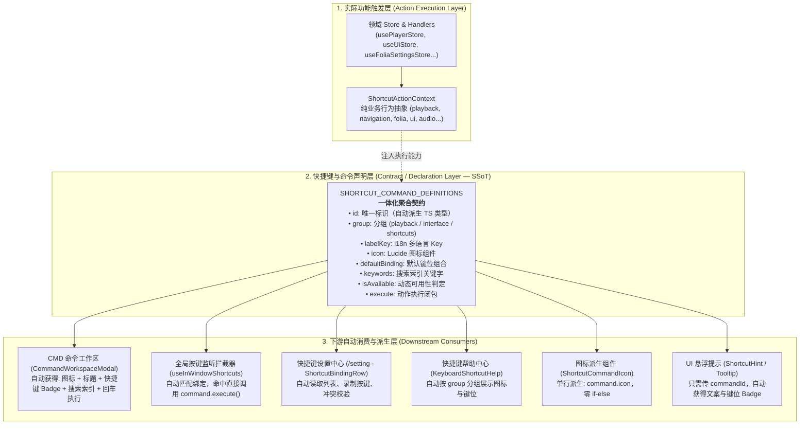

# 快捷键与命令套链分层架构

> Status: Proposed Owner: Frontend & Desktop Team Reference: [shortcut_chain_architecture_plan.md](file:///Users/momo/.gemini/antigravity/brain/dc2bfa60-ec02-40d5-9b5d-9d17c45aec4e/shortcut_chain_architecture_plan.md)

本文定义 Scopify 前端与桌面端统一的**快捷键与命令套链分层架构（Chained Shortcut & Command Architecture）**。它确立了从“功能触发”到“一体化声明”再到“下游多端消费”的单向数据流与标准协议，解决过去快捷键定义散落、执行割裂以及下游命令面板重复注入的结构性问题。

---

## 1. 目标与设计背景

### 1.1 现状与痛点

在以往的实现中，添加或修改一个全局快捷键或可执行命令，开发者需要在至少 5~6 个不相关的文件中重复进行手工样板代码装配（Plumbing）：

```text
旧版分散结构（无统一真实源）：
types/shortcuts.ts ───────────► 手写 40+ 个字符串联合类型（ShortcutCommandId）
constants/shortcuts.ts ───────► 配置基础元数据（id, labelKey, defaultBinding...）
components/ShortcutCommandIcon ► 40+ 行 if (commandId === '...') return <Icon />
hooks/useShortcutCommands ────► 220+ 行巨型 switch (commandId) { case ... }
components/commandWorkspace ──► CMD 模态框手动映射、硬编码过滤与重复注入
components/shortcuts/Help ────► 快捷键帮助弹窗单独聚合
```

这带来了显著的架构腐化风险：

1. **类型与实现脱节**：`ShortcutCommandId` 依赖手动维护联合类型，新增命令时容易漏写或类型拼写错误。
2. **状态机膨胀**：`useShortcutCommands` 随着功能扩展变成一个维护困难的庞大 `switch` 块，执行上下文与命令声明彻底割裂。
3. **图标强行硬编码**：图标与命令元数据分离，导致每一个新增的快捷键都必须在 `ShortcutCommandIcon` 里加一个 `if` 分支。
4. **下游重复注入**：CMD 模态框（`CommandWorkspaceModal`）、Folia 命令树等下游各自分割，有的需要手动 filter，有的要单独写 mapping，命令无法自动流通。

### 1.2 架构目标

建立**以「声明层」为唯一真实源（Single Source of Truth, SSoT）**的套链驱动架构：

- **声明即所有**：命令的唯一标识、分组、多语言文本、图标、默认按键、动态可用性与执行闭包，在一个对象内一体化声明。
- **类型自动推导**：`ShortcutCommandId` 联合类型直接从声明契约表中推导，告别手工手写 union。
- **下游自动派生**：消灭巨大的 switch 状态机和图标 if-else 穷举；CMD Modal、快捷键设置中心、帮助弹窗和按键监听器全部自动消费该声明表。

---

## 2. 核心分层模型 (Three-Tier Chain Model)

架构自底向上划分为三层，形成严格的单向依赖链：

$$\textbf{实际功能触发层} \longrightarrow \textbf{快捷键与命令声明层} \longrightarrow \textbf{下游自动消费与派生层}$$



---

## 3. 各层职责与协议定义

### 3.1 Layer 1: 实际功能触发层 (Action Execution Layer)

负责将具体业务领域的 Store、Router 与 API 抽象为纯粹的领域动作上下文 `ShortcutActionContext`。此层只专注于“怎么执行动作”，不关心快捷键是什么、图标是什么。

```ts
export interface ShortcutActionContext {
  playback: {
    toggle(): void;
    toggleLike(): void;
    previous(): void;
    next(): void;
    setVolume(volume: number): void;
    toggleMute(): void;
    seekBy(deltaMs: number): void;
  };
  navigation: {
    navigateTo(path: string): void;
    navigateHome(): void;
    back(): void;
    forward(): void;
  };
  ui: {
    toggleSearch(): void;
    toggleCommandPalette(): void;
    toggleSidebar(): void;
    toggleQueue(): void;
    toggleNowPlayingPanel(): void;
    toggleShortcutHelp(): void;
  };
  folia: {
    toggleLyricStage(): void;
    toggleStageSettings(): void;
    openFoliaSettings(): void;
    openFoliaThemeLibrary(): void;
  };
  audio: {
    toggleAudioSettings(): void;
    toggleAudioOutputDevice(): void;
  };
  desktop: {
    toggleDynamicIsland(): void;
    toggleTaskbarLyric(): void;
    toggleDesktopSubtitle(): void;
    toggleSubtitleControls(): void;
    toggleDesktopController(): void;
    toggleDesktopMusicMode(): void;
    toggleFullscreen(): void;
    toggleDeveloperTools(): void;
  };
  lattice: {
    viewList(): void;
    viewLattice(): void;
    toggleLightsOff(): void;
  };
  track: {
    openCurrentComments(): void;
  };
  updates: {
    openWhatsNew(): void;
  };
}
```

### 3.2 Layer 2: 快捷键声明层 (Contract Layer — SSoT)

本层是整个快捷键与可执行命令系统的唯一真实源。所有的元数据与行为在此一次性声明完毕。

#### 核心契约接口

```ts
export interface ShortcutCommandContract {
  id: string;
  group: ShortcutGroup;
  labelKey: TranslationKey;
  icon: LucideIcon;
  defaultBinding: ShortcutBinding | null;
  keywords?: string;
  scope?: ShortcutScope;
  isAvailable?: (ctx: ShortcutAvailabilityContext) => boolean;
  execute: (ctx: ShortcutActionContext) => void | Promise<void>;
}
```

#### 声明表与类型自动派生

```ts
export const SHORTCUT_COMMAND_DEFINITIONS = [
  {
    id: "toggle-playback",
    group: "playback",
    labelKey: "shortcuts.command.togglePlayback",
    icon: PlayCircle,
    defaultBinding: { key: "Space" },
    execute: (ctx) => ctx.playback.toggle(),
  },
  {
    id: "toggle-stage-settings",
    group: "interface",
    labelKey: "shortcuts.command.toggleStageSettings",
    icon: Settings2,
    keywords: "舞台控制 播放面板 stage settings panel 歌词设置 封面 控制 音质",
    defaultBinding: { key: "Comma", primary: true, alt: true },
    execute: (ctx) => ctx.folia.toggleStageSettings(),
  },
  {
    id: "navigate-home",
    group: "interface",
    labelKey: "social.home",
    icon: House,
    keywords: "首页 首頁 返回首页 回到首頁 home",
    defaultBinding: { key: "Home" },
    execute: (ctx) => ctx.navigation.navigateHome(),
  },
  // ... 其余系统命令一体化声明
] as const satisfies readonly ShortcutCommandContract[];

// 类型完全由契约列表自动推导，消除手工字符串联合类型维护：
export type ShortcutCommandId = (typeof SHORTCUT_COMMAND_DEFINITIONS)[number]["id"];
```

---

## 4. Layer 3: 下游消费端自动化规范

### 4.1 全局命令分发器 (`useShortcutCommands`)

消灭以往超过 200 行的 `switch-case`，收敛为一行极简分发：

```ts
export function useShortcutCommands(options?: ShortcutCommandExecutorOptions) {
  const actionContext = useShortcutActionContext(options);
  return useCallback(
    (commandId: ShortcutCommandId) => {
      const command = getCommandDefinition(commandId);
      if (command) void command.execute(actionContext);
    },
    [actionContext],
  );
}
```

### 4.2 图标渲染组件 (`ShortcutCommandIcon`)

消灭以往超过 40 行的 `if-else` 穷举，直接由命令对象派生图标：

```tsx
export function ShortcutCommandIcon({ className = "size-4", commandId }: ShortcutCommandIconProps) {
  const Icon = getCommandDefinition(commandId)?.icon;
  return Icon ? <Icon className={className} /> : null;
}
```

### 4.3 命令工作区（CMD Modal / `CommandWorkspaceModal`）

CMD Modal 无需在各处页面中重复注入命令，直接读取声明契约：

- **图标**：直接读取 `command.icon`
- **标题**：读取 `t(command.labelKey)`
- **按键提示**：读取 `command.binding`，自动渲染按键 Badge
- **模糊搜索**：基于 `command.label` 与 `command.keywords` 进行多语言匹配
- **回车执行**：直接触发 `executeShortcut(command.id)`

### 4.4 快捷键设置页与帮助弹窗

- `/setting` 的 `ShortcutBindingRow` 与 `KeyboardShortcutHelp` 弹窗无需任何特殊适配，直接从全局注册表读取分组信息、图标、键位与冲突检测。

---

## 5. 键位冲突与防误触守则

在为命令声明快捷键时，必须遵循以下工程约束：

| 约束维度 | 规则 | 避坑实例 |
| :-- | :-- | :-- |
| **浏览器保留快捷键** | 严禁使用带有 `KeyS` 的全局组合键（`Cmd+S`、`Cmd+Shift+S` 等） | 避免触发 Chrome/Edge 的保存网页或长截图 |
| **系统级热键隔离** | 避免使用 macOS 系统保留热键（如 `Cmd+H` 隐藏窗口、`Cmd+Alt+H` 隐藏其他） | 使用非字母键（如 `,`、`.`）配合修饰键 |
| **路由认知一致性** | 保持与 Vim 路由风格（`Alt+Shift+H` 后退、`Alt+Shift+L` 前进）的隔离 | 回到首页使用单键 `Home`，不占用 `H` 字母键 |
| **沉浸全屏单键体验** | 全屏舞台（Lyric Stage）内支持单手盲操单键（如 `P` 呼出面板、`Escape` 分层退出） | 单键仅在非输入聚焦状态下生效 |

---

## 6. 演进与落地计划

1. **Phase 1（基础设施）**：建立 `ShortcutActionContext` 聚合器，重构 `types/shortcuts.ts` 与 `constants/shortcuts.ts` 为一体化契约声明。
2. **Phase 2（执行层收敛）**：重构 `useShortcutCommands` 与 `ShortcutCommandIcon`，彻底移除旧版巨型 `switch` 与 `if-else`。
3. **Phase 3（下游自动化）**：打通 `CommandWorkspaceModal` 自动消费层，清理各组件内部零散的重复注入逻辑。
4. **Phase 4（验证与保障）**：运行架构检查、主题守卫与自动化测试集，确保 100% 行为向后兼容。
